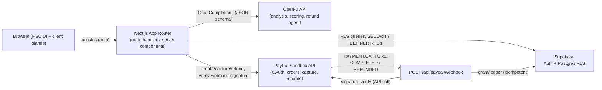

# CreditAI Resume Roaster

CreditAI is a resume tool that proves its claims: it analyzes your resume against a real job description with real OpenAI inference, shows a before/after match estimate, and diffs the rewritten resume against your original to flag every fact the AI added. Billing is atomic credit-based. PayPal Sandbox flows (orders, captures, partial refunds, verified webhooks) are implemented and covered by the automated test suite (vitest, with PayPal/OpenAI mocked in tests only); a manual verification checklist is at the end of this README.

## Problem and audience

- Job seekers preparing for online hiring processes mostly endure time-boxed, evidence-based screens: recruiters compare candidates against a concrete job description, not vibes. Generic AI resume tools reply with subjective advice ("add more metrics") and no receipts; worse, auto-rewrites commonly invent companies, years, or achievements. The same tooling gap applies to Indonesian campus hiring programs, which run screening in both English and Indonesian.
- Audience: entry-level and early-career developers and analysts (Indonesian or English) applying through online job boards, cheap hiring assessments, or campus recruitment programs.
- Specific pain this solves: unverifiable AI advice, fabricated rewrites, and opaque credit systems. CreditAI shows requirement-by-requirement evidence, flags unverified details deterministically, meters analysis with atomic credits, and supports partial refunds of unused credits.

## Live demo

Placeholder: https://your-deployment.vercel.app
Judge quick-start page: https://your-deployment.vercel.app/judges

## Screenshots

Placeholders (add real captures):
- Landing page
- Analysis result (score card, before/after estimate, fabrication check, requirement matches)
- Credits page (inline PayPal Sandbox buttons)
- Transactions page (ledger with refund compensation entries)
- /judges (system status card + 5-step quick start)
- Refund panel (AI decision message with guardrails)

## Features

- Real OpenAI inference with structured JSON output (no mock data in production paths).
- Before/after match estimate ("AI estimate, not a guarantee") included in the same credit.
- Deterministic fabrication guard: the rewrite is diffed against your original resume; flagged details are listed with chips for verification. One automatic stricter rewrite retry if too many details are flagged.
- Indonesian/English detection; answers follow the resume's language.
- Atomic credit reservation/consume/refund; per-user and global daily caps; stale reservation release.
- PayPal Sandbox payments: inline SDK buttons with a redirect fallback, server-side prices only, idempotent orders and captures.
- Partial refunds of unused credits through the PayPal Refunds API with ledger compensation; AI refund agent inside deterministic guardrails.
- Verified webhooks (PAYMENT.CAPTURE.COMPLETED and PAYMENT.CAPTURE.REFUNDED) with ledger-level deduplication.
- Privacy by default: resume text is not stored unless you opt in; otherwise only character counts are stored; one-click deletion of analysis data; scheduled purge of stale inputs (30 days); public /privacy notice.
- User-specific analysis history and full transaction ledger; PDF upload for resumes.
- Public system status endpoint (/api/health) and judge quick-start page (/judges).

## Architecture

## How PayPal is used

Server-side endpoints (all called only from route handlers; docs at developer.paypal.com/docs/api/overview/):

- `POST /v1/oauth2/token` - client-credentials access token. Docs: developer.paypal.com/docs/api/oauth2/
- `POST /v2/checkout/orders` - order creation with server-side prices and `PayPal-Request-Id` (idempotency). Docs: developer.paypal.com/docs/api/orders/v2/
- `POST /v2/checkout/orders/{id}/capture` - capture after buyer approval; ambiguous failures are resolved by re-querying via the Orders get endpoint (`ORDER_ALREADY_CAPTURED`).
- `GET /v2/checkout/orders/{id}` - recovery lookup for captures.
- `POST /v2/payments/captures/{id}/refund` - partial refund of unused credits with `PayPal-Request-Id` and `note_to_payer`. Docs: developer.paypal.com/docs/payments/capture-refunds/
- `POST /v1/notifications/verify-webhook-signature` - webhook authenticity check before processing. Docs: developer.paypal.com/docs/webhooks/

Client-side: PayPal JS SDK (`https://www.paypal.com/sdk/js?client-id=...&currency=USD&intent=capture`) rendered as inline buttons on /credits, with the classic redirect flow as fallback. Buyer credentials on /judges are Sandbox-only personal accounts; no real money moves.

Prices: 10 credits $1.00, 50 credits $4.00, 100 credits $7.00. The client only displays package ids; the server recomputes amounts. Refunds are per credit (`amount / credits`, integer cents), allocated to the newest order first.

Webhooks handled: `PAYMENT.CAPTURE.COMPLETED` (credit grant, idempotent by capture id + event id) and `PAYMENT.CAPTURE.REFUNDED` (ledger and counters, idempotent by refund id; app-initiated refunds skip re-collection via `refund_requests.paypal_refund_id`).

## How AI is used

- Analysis (model configurable via `OPENAI_MODEL`, default `gpt-4o-mini`): one structured Chat Completions call with a strict JSON schema (`lib/ai-schema.ts`), validated with Zod. Prompt includes requirement matches with evidence, 3 strengths, 5 weaknesses, missing keywords, recommendations, and a rewritten resume whose facts must come from the original.
- Before/after estimate: a cheap second call (`scoreResume`) scores the rewritten resume with the same rubric; failure omits the delta silently at no user cost.
- Fabrication guard (`lib/fabrication-guard.ts`): deterministic extraction of numbers with units, percentages, money, years, and capitalized multi-word names from the rewrite, matched against the original resume (normalizing thousand separators and money formats); job description mentions count as allowed only on lines with a skills context. More than 2 flagged details triggers one automatic rewrite retry with a stricter instruction, at no extra credit.
- Refund agent (`lib/refund-agent.ts`): "AI proposes, code disposes." The agent never decides: once the deterministic checks pass (refundable = purchased - refunded capped per order, max 3 refund requests per 30 days, orders within the 14-day window, allocation in integer cents in `lib/refund-math.ts`), the server approves and the model only writes the 2-3 sentence customer message. Denials are purely deterministic (limit reached, not enough unused credits, window expired) and happen before any AI call. If the model call fails, a fixed fallback message is used and the refund still processes.
- Language handling (`lib/language.ts`): dictionary heuristic (no dependency) sets the output language to match the resume.
- Evaluation harness: `npm run eval` runs 5 fixture pairs against the real model and reports the average unverified-detail count and average score delta (costs real API money; not run in CI; see docs/EVALUATION.md).

## AI tools used

Product: OpenAI Chat Completions (`gpt-4o-mini` by default) for analysis, rewrite scoring, and the refund agent. Development: OpenCode assistant (GLM) for scaffolding, refactoring, and test generation. See AI_TOOLS.md (Devpost "Tools used" text is in DEVPOST.md).

## Setup

1. `npm install`
2. Create a Supabase project; run migrations from `supabase/migrations/` in order in the SQL editor: `0001_init.sql`, `0002_paypal_grant.sql`, `0003_ai_reservations.sql`, `0004_stale_reservations.sql`, `0005_demo_sessions.sql`, `0006_refunds.sql`, `0007_purge_inputs.sql`, `0008_demo_hardening.sql`.
3. Copy `.env.example` to `.env.local` and fill values (Supabase URL/anon/service keys, OpenAI key, PayPal sandbox client id/secret/webhook id, app URL, repo URL, cost caps, salt).
4. PayPal Sandbox: create an app at developer.paypal.com, set its webhook URL to `https://<your-domain>/api/paypal/webhook`, subscribe to both `PAYMENT.CAPTURE.COMPLETED` and `PAYMENT.CAPTURE.REFUNDED`, copy the webhook id into `PAYPAL_WEBHOOK_ID`, and copy client id/secret into `PAYPAL_CLIENT_ID`/`PAYPAL_CLIENT_SECRET` (plus `NEXT_PUBLIC_PAYPAL_CLIENT_ID` for inline buttons).
5. Schedule the input purge (DEPLOYMENT.md, pg_cron): `select cron.schedule('purge-job-inputs','45 2 * * *',$$select public.purge_old_job_inputs(interval '30 days');$$);` and demo cleanup on the same page.
6. `npm run dev` (local) or `npm run build && npm start`. Tests: `npm test` (82 tests, vitest; PayPal/OpenAI are mocked in tests only). Typecheck: `npm run typecheck`. Lint: `npm run lint`.

## Security and idempotency

- RLS on all app tables; service role key only server-side; PayPal/OpenAI secrets never in client code.
- Credit mutations only through SECURITY DEFINER RPCs with row locks and idempotency keys; amounts never trust the client.
- Orders, captures, grants, refunds, and webhook events are idempotent (ledger keys, `PayPal-Request-Id`, unique webhook event ids).
- Rate limits: per-user daily analysis cap, global daily cap, 3 demo sessions/IP/hour, 3 refund requests/30 days, PayPal order cap per day.
- Privacy: no retention by default (character counts only), one-click deletion on the dashboard, scheduled 30-day purge, public /privacy notice.

## Limitations (honest)

- Payments are Sandbox only; live mode is supported by config (`PAYPAL_ENV=live`) but is not to be trusted without your own QA and PayPal policies.
- LLM output can still drift in free-text fields; the fabrication guard is a heuristic verifier, not a fact-checker.
- Rate limiters are in-memory + database-backed; horizontal scale needs a shared store (e.g. Upstash) for full accuracy.
- The demo account flow expects Supabase email confirmation to be disabled in the project settings.
- The public URL is not verified in this environment (no deployment performed from here); `npm run build` must pass locally.

## Verified manually on 2026-10-27

Filled in by the maintainer after testing the deployed URL (all unticked until then):

- [ ] Sign-up works; demo session creates an account with 5 credits.
- [ ] Buying a credit package with a Sandbox buyer credits the account after the capture (webhook path included).
- [ ] Analysis consumes 1 credit, returns evidence-based score/roast/rewrite, and appears in history.
- [ ] Partial refund of unused credits processes on PayPal Sandbox and the ledger shows the compensation entry.
- [ ] The `PAYMENT.CAPTURE.REFUNDED` webhook does not double-deduct credits for an app-initiated refund.
- [ ] One-click data deletion empties analysis history and counts.
- [ ] `/api/health` reports ok on the deployed URL.
- [ ] All `.env.example` variables are set in the deployment environment.

## License

MIT. See `LICENSE`.
