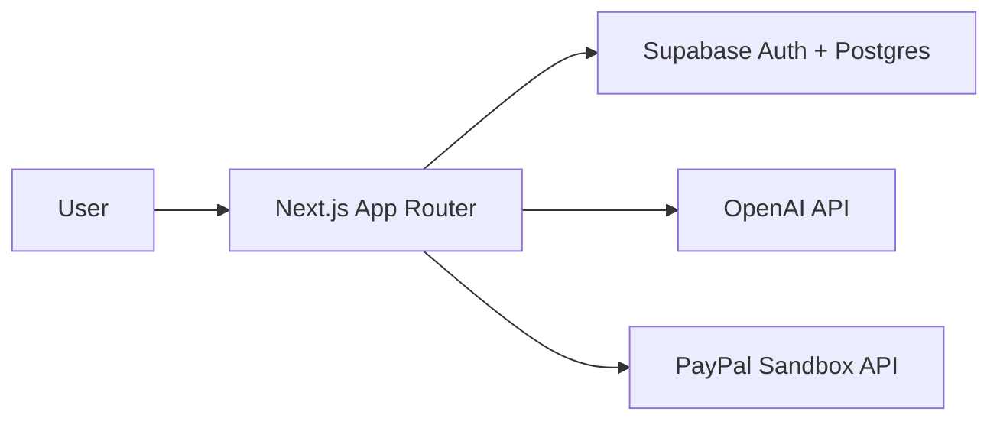

# CreditAI Resume Roaster

AI-powered resume analysis and rewriting with a credit-based billing flow. Paste a resume and a job description to get a match score, strengths, weaknesses, recommendations, and a rewritten resume. Purchase credits via PayPal Sandbox.

## Live demo
Placeholder: https://your-deployment.vercel.app

## Features
- Real OpenAI inference with structured JSON output.
- Atomic credit reservation/finalization/refund.
- PayPal Sandbox payments with webhook verification.
- Idempotent orders, captures, grants, webhook events.
- User-specific analysis and transaction history.
- PDF upload for resumes.

## Architecture

## Setup
1. `npm install`
2. Copy `.env.example` to `.env.local` and fill values.
3. Run migrations `0001_init.sql`, `0002_paypal_grant.sql`, `0003_ai_reservations.sql`, `0004_stale_reservations.sql`.
4. `npm run dev`

## Environment variables
See `.env.example`.

## PayPal Sandbox
Create a sandbox app, set webhook URL to `/api/paypal/webhook`, subscribe to `PAYMENT.CAPTURE.COMPLETED`.

## Judge test script
See `/judges` page.

## Security & idempotency
- RLS on all tables; service role only server-side.
- Credit mutations via SECURITY DEFINER RPCs with row locks.
- Webhook signature verified via PayPal API.
- Idempotency keys on orders, captures, grants, webhook events.

## License
MIT. See `LICENSE`.

## AI tools
See `AI_TOOLS.md`.