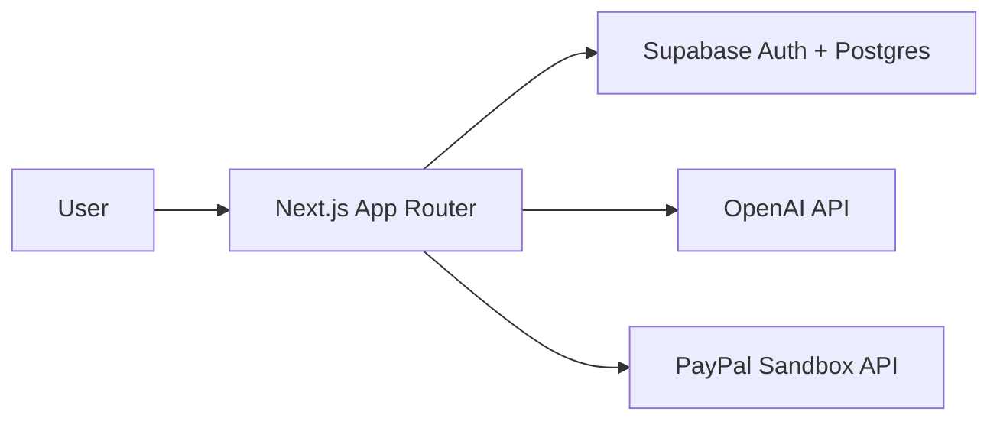

# CreditAI Resume Roaster

AI-powered resume analysis and rewriting with a credit-based billing flow. Paste a resume and a job description to get a match score, strengths, weaknesses, recommendations, and a rewritten resume. Purchase credits via PayPal Sandbox.

## Live demo
Placeholder: https://your-deployment.vercel.app

## Features
- Real OpenAI inference with structured JSON output.
- Before/after match estimate ("AI estimate, not a guarantee") included in the same credit.
- Deterministic fabrication guard: the rewrite is checked against your original resume; flagged details are shown for verification.
- Indonesian/English detection with answers in the resume's language.
- Atomic credit reservation/finalization/refund.
- PayPal Sandbox payments with webhook verification.
- Idempotent orders, captures, grants, webhook events.
- Privacy by default: resume text is not stored unless you opt in (checkbox on /analyze); character-count-only history otherwise; user-triggered one-click deletion of analysis data on the dashboard; public /privacy notice.
- User-specific analysis and transaction history.
- PDF upload for resumes.

## Claims and evaluation

See `docs/EVALUATION.md` and `npm run eval` (optional, costs real API money, not run in CI):
average unverified details and average rewritten-score delta across 5 fixtures.

## Architecture

## Setup
1. `npm install`
2. Copy `.env.example` to `.env.local` and fill values.
3. Run migrations `0001_init.sql`, `0002_paypal_grant.sql`, `0003_ai_reservations.sql`, `0004_stale_reservations.sql`, `0005_demo_sessions.sql`, `0006_refunds.sql`, `0007_purge_inputs.sql` (in order).
4. `npm run dev`

## Environment variables
See `.env.example`.

## PayPal Sandbox
Create a sandbox app at developer.paypal.com, set the webhook URL to `/api/paypal/webhook`.

Subscribe the webhook to **both** events:
- `PAYMENT.CAPTURE.COMPLETED`
- `PAYMENT.CAPTURE.REFUNDED` (reflects dashboard refunds in the ledger; do not skip it)

### How PayPal is used
Endpoints called server-side:
- `POST /v1/oauth2/token` — client-credentials access token (lib/paypal.ts `getAccessToken`).
- `POST /v2/checkout/orders` — create an order with server-side prices and `PayPal-Request-Id` (idempotency).
- `POST /v2/checkout/orders/{id}/capture` — capture after buyer approval.
- `GET /v2/checkout/orders/{id}` — recovery lookups when capture is ambiguous (`ORDER_ALREADY_CAPTURED`).
- `POST /v2/payments/captures/{id}/refund` — partial refunds of unused credits, with `PayPal-Request-Id` and `note_to_payer`.
- `POST /v1/notifications/verify-webhook-signature` — webhook authenticity verification.

Client-side:
- PayPal JS SDK `https://www.paypal.com/sdk/js?client-id=...&currency=USD&intent=capture` rendered inline via Buttons on `/credits`, with the classic redirect flow as fallback.

Webhooks handled: `PAYMENT.CAPTURE.COMPLETED` (grant credits, idempotent by event + capture id) and `PAYMENT.CAPTURE.REFUNDED` (ledger + counters, idempotent by refund id; app-initiated refunds are skipped via `refund_requests.paypal_refund_id`).

## Judge test script
See `/judges` page.

## Security & idempotency
- RLS on all tables; service role only server-side.
- Credit mutations via SECURITY DEFINER RPCs with row locks.
- Webhook signature verified via PayPal API.
- Idempotency keys on orders, captures, grants, webhook events.

## License
MIT. See `LICENSE`.

## AI tools
See `AI_TOOLS.md`.