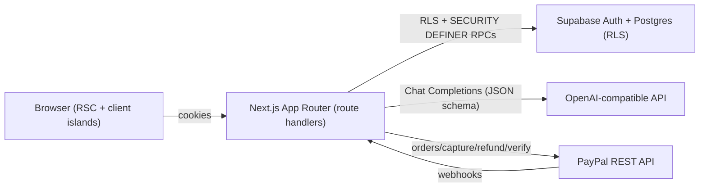

# Architecture — CreditAI

## System overview

## Request lifecycle (analysis)

1. Auth check via Supabase session.
2. Input validation (Zod) + daily caps + rate limit.
3. Idempotency check by `idempotency_key`.
4. Credit reservation via `reserve_credits` RPC.
5. Job row insert (`status=running`).
6. `runAnalysisPipeline`: model call, schema validation, fabrication retry, coverage, guarantee retry, scoring pass.
7. Persist result + coverage columns; consume reservation.
8. Guarantee stamp or automatic refund via SQL RPC.
9. Return `{ jobId, status, result }`.

## Credit lifecycle

`reserve` -> `consume` (on success) | `refund` (on failure). Balance mutations only via RPCs with row locks.

## PayPal payment lifecycle

`created` -> `approved` (buyer) -> `captured` (server verifies amount/currency/status) -> `credits_granted` (idempotent by capture id). Webhooks reconcile asynchronously.

## Refund lifecycle

Deterministic eligibility (ownership, refundable balance, 14-day window, 3 requests/30 days, integer cents) -> PayPal Refunds API -> ledger compensation. AI only writes the customer message.

## Trust boundaries

- Resume and job description are untrusted data (prompt injection defense).
- Browser never determines price/credit amounts.
- Service role key server-only.
- Webhook authenticity verified via PayPal API before processing.